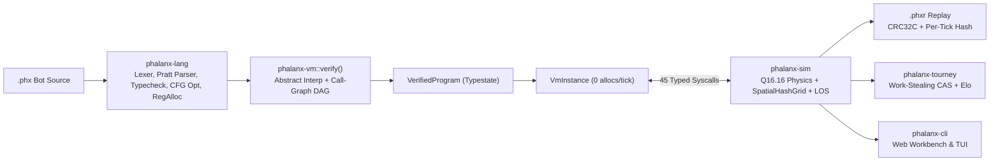

# Phalanx

[](https://github.com/Praashon/phalanx/actions/workflows/ci.yml)


**Sandboxed Autonomous Bot Battle Arena built from scratch in Rust: custom `.phx` optimizing compiler, eBPF-inspired static bytecode verifier, zero-allocation 32-bit RISC VM, bit-exact Q16.16 physics, and an interactive browser workbench.**

Phalanx lets programmers write autonomous combat agents in a statically typed scripting language (`.phx`), verifies their compiled bytecode for safety and termination before execution, and battles them across deterministic arenas and parallel Elo tournaments.



---

## Architecture & Crates

Core engine crates enforce `#![forbid(unsafe_code)]` with zero external runtime dependencies inside the VM, compiler, and physics simulator.

| Crate | Responsibility | Runtime Deps | Safety |
| :--- | :--- | :--- | :--- |
| [`phalanx-vm`](crates/phalanx-vm/src/lib.rs) | 32-bit ISA (50 opcodes), 45 syscalls, `.phxb` CRC32C codec, disassembler, static verifier, 0-alloc VM | None | `#![forbid(unsafe_code)]` |
| [`phalanx-lang`](crates/phalanx-lang/src/lib.rs) | `.phx` pure-integer lexer, Pratt parser, strict type checker, CFG optimizer, loop-aware register allocator | `phalanx-vm` | `#![forbid(unsafe_code)]` |
| [`phalanx-sim`](crates/phalanx-sim/src/lib.rs) | Q16.16 math and trig LUTs, `SpatialHashGrid`, ray-box LOS occlusion, physics arena, `.phxr` replays | `phalanx-vm` | `#![forbid(unsafe_code)]` |
| [`phalanx-tourney`](crates/phalanx-tourney/src/lib.rs) | Cache-line-aligned CAS work-stealing pool, deterministic Elo reduction, cross-thread audit | Workspace + `serde` | `#![forbid(unsafe_code)]` |
| [`phalanx-cli`](crates/phalanx-cli/src/main.rs) | `phalanx` CLI, embedded HTTP Web Workbench (`serve`), Ratatui TUI (`watch`), compiler & replay tools | `clap`, `ratatui`, `crossterm`, `serde_json` | Safe Rust |

---

## Engineering Highlights

- **eBPF-Style Static Verifier (`phalanx-vm`)**: Uses a Rust typestate boundary (`VerifiedProgram` can only be produced by [`verify`](crates/phalanx-vm/src/verifier.rs)). Performs monotone abstract interpretation over `RegState::{Uninit, Typed(ValType)}` across CFG merges, proves all branch offsets remain inside function bounds, checks complete return paths, and verifies call-graph acyclicity (`MAX_CALL_DEPTH = 16`).
- **Zero-Allocation Gas-Metered VM (`phalanx-vm`)**: `VmInstance` embeds fixed call frames (`[Frame; 16]`) and persistent state (`[i32; 64]`), proven to perform **0 heap allocations** over 1,000 ticks using a custom `#[global_allocator]` harness ([`zero_alloc.rs`](crates/phalanx-vm/tests/zero_alloc.rs)). Infinite loops suspend cleanly via instruction-level gas metering (`ExecStatus::OutOfGas`).
- **Optimizing `.phx` Compiler (`phalanx-lang`)**: Parses Q16.16 fixed-point literals with pure `u128` integer math, enforces explicit `i32`/`fix`/`bool` conversions, runs fixed-point CFG optimizations (constant folding, algebraic identities, copy propagation, unreachable block pruning, trapping-aware DCE), and allocates registers via backward dataflow liveness over Reverse Post-Order blocks.
- **Bit-Exact Q16.16 Determinism (`phalanx-sim`)**: Zero IEEE-754 floats in simulation physics or bot math. Uses compile-time Q32.32-generated trigonometric tables, integer `isqrt`, `Xoshiro256**` per-bot streams, simultaneous intent resolution, and per-tick 64-bit FNV-1a world hashing. Self-contained `.phxr` replays verify every tick hash from scratch.
- **Lock-Free Work-Stealing Tournaments (`phalanx-tourney`)**: `WorkShard` packs `(head: u32, tail: u32)` into a `#[repr(align(64))]` `AtomicU64` per worker thread over `std::thread::scope`. Match outcomes sort by `match_idx` before Elo updates so ratings remain invariant across thread counts.
- **Embedded Web Workbench & Terminal Debugger (`phalanx-cli`)**: Zero-dependency Rust HTTP/1.1 server ([`server.rs`](crates/phalanx-cli/src/server.rs)) serving a split-pane HTML5 Canvas arena, timeline scrubber, live `.phx` code editor with static verifier feedback, step-through VM register/disassembly debugger, and parallel Elo benchmark runner.

---

## Quickstart

### 1. Launch the Web Workbench (Recommended)

```bash
cargo run --release
```

Open the printed URL (default `http://127.0.0.1:8080`, with automatic port fallback if busy):

- **Arena**: 60 FPS interpolated Canvas simulation, pointer-draggable timeline scrubber with kill markers, copyable 64-bit state hash, event console, and **VM Inspector** for stepping through live instructions and `r0..r15` registers.
- **Editor**: Edit any `.phx` bot or write your own, compare `-O1` vs `-O0` optimization passes, inspect bytecode disassembly, CFG IR, and all 45 syscalls, then click **Deploy to Arena**.
- **Benchmarks**: Run multi-core Round-Robin 1v1 or Battle Royale tournaments with cross-thread determinism auditing and Elo standings.

### 2. CLI Commands

```bash
# Watch all 5 built-in champion bots live in the Ratatui terminal UI
cargo run --release -- watch

# Run headless and save a self-contained deterministic replay
cargo run --release -- watch --headless --seed 42 --save-replay demo.phxr

# Re-simulate every tick and verify every 64-bit world hash
cargo run --release -- replay demo.phxr --verify

# Print optimized IR, disassembly, and static verifier report for a bot
cargo run --release -- compile bots/kiter.phx --dump-ir --disasm --verify-report

# Run a 10-round parallel tournament with cross-thread determinism auditing
cargo run --release -- tourney --rounds 10 --audit-determinism
```

---

## Bot Language (`.phx`)

```rust
// Excerpt from bots/kiter.phx
const PROJ_SPEED_MED: fix = 1.85;
state strafe_dir: i32 = 1;

fn lead_angle(tid: i32, proj_speed: fix) -> fix {
    let t = target_dist(tid) / proj_speed;
    let px = target_x(tid) + target_vx(tid) * t;
    let py = target_y(tid) + target_vy(tid) * t;
    return atan2(py - self_y(), px - self_x());
}

fn tick() {
    let bid = nearest_bullet();
    if bid >= 0 && bullet_dist(bid) < 13.0 {
        let dodge = atan2(bullet_vy(bid), bullet_vx(bid)) + HALF_PI * to_fix(strafe_dir);
        let _d = dash(dodge);
        thrust(dodge, 1.0);
    }

    let tid = radar_nearest();
    if tid >= 0 && self_energy() >= 24 {
        let _f = fire(lead_angle(tid, PROJ_SPEED_MED), 2);
    }
}
```

Included showcase bots in [`bots/`](bots): [`kiter.phx`](bots/kiter.phx), [`berserker.phx`](bots/berserker.phx), [`sentry.phx`](bots/sentry.phx), [`vanguard.phx`](bots/vanguard.phx), [`ghost.phx`](bots/ghost.phx), and [`rogue_loop.phx`](bots/examples/rogue_loop.phx) (infinite-loop gas containment demo).

---

## Measured Performance

Measured in `--release` on Windows (`rustc 1.99.1`, 16 worker threads for the tournament run):

| Benchmark / Workload | Measured Result | Source |
| :--- | :--- | :--- |
| `vm_250_iter_loop_1000_insns` (Criterion) | **8.43 us** mean (`[8.07 us .. 8.84 us]`) | [`vm_bench.rs`](crates/phalanx-vm/benches/vm_bench.rs) |
| `sim_5bot_arena_step_tick` (Criterion, 5 bots + physics + spatial grid + hash) | **3.97 us / tick** (`[3.78 us .. 4.14 us]`) | [`sim_bench.rs`](crates/phalanx-sim/benches/sim_bench.rs) |
| 10-round 1v1 Tournament + 100% Audit (`200` total matches, 16 threads) | **0.053 s** (**3,794.5 matches/s**, **257.40 VM MIPS**) | `phalanx tourney --rounds 10 --audit-determinism` |
| VM heap allocations per tick (`1,000` ticks) | **0 allocations** | [`zero_alloc.rs`](crates/phalanx-vm/tests/zero_alloc.rs) |

---

## Verification & Design Docs

```bash
cargo fmt --all -- --check
cargo clippy --workspace --all-targets -- -D warnings
cargo test --workspace
cargo bench -p phalanx-vm -p phalanx-sim
```

The workspace includes **32 automated tests** covering adversarial raw-bytecode verifier rejections, `proptest` bytecode/decoder fuzzing, compiler optimization equivalence fuzzing (`OptLevel::None` vs `OptLevel::Standard`), spatial-hash vs brute-force oracle validation, custom `GlobalAlloc` zero-allocation proofs, `.phxr` replay tamper detection, HTTP API integration tests, and multi-thread tournament determinism checks.

- [Architecture Guide](docs/ARCHITECTURE.md)
- [ADR-001: Fixed-Point Determinism & Pure-Integer Math](docs/adr/ADR-001-fixed-point-determinism.md)
- [ADR-002: Defense-in-Depth Bot Sandboxing](docs/adr/ADR-002-defense-in-depth-sandboxing.md)
- [ADR-003: Register ISA & Zero-Allocation VM](docs/adr/ADR-003-register-isa-and-zero-alloc-vm.md)
